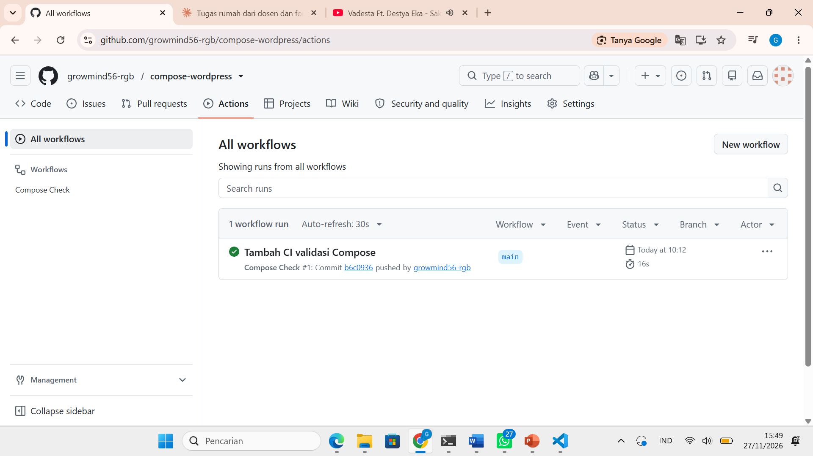
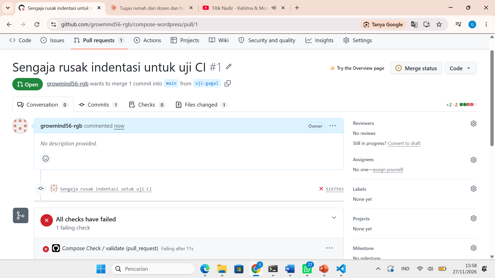
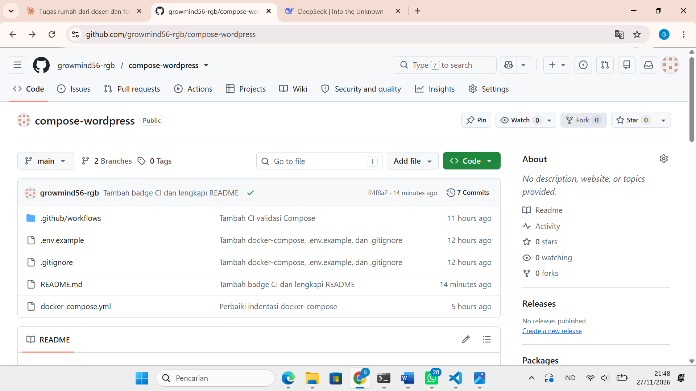

# Tugas Minggu 11: CI untuk Repo Compose

**Nama:** Resty Putri Septiani
 
**NIM:** 202557201049
 
**Mata kuliah:** Teknologi Open Source

## Deskripsi
Workflow ini memvalidasi file docker-compose.yml menggunakan docker compose config -q setiap kali ada push ke branch main dan setiap ada Pull Request. Dengan demikian, kesalahan sintaks atau indentasi pada file Compose dapat terdeteksi otomatis sebelum perubahan digabungkan.
## Isi repositori
- `.github/workflows/compose-check.yml` : workflow CI
- `docker-compose.yml` : stack WordPress + MariaDB (tugas minggu 10)
- `.env.example` : contoh variabel lingkungan tanpa rahasia asli
- `.gitignore` : mengabaikan `.env`

## Cara kerja workflow
Workflow dipicu oleh `push` ke branch `main` dan event `pull_request`. Job `validate` berjalan di runner `ubuntu-latest`.
Ada tiga langkah di dalamnya: 
1) checkout repositori menggunakan `actions/checkout@v6` 
2) menyalin `.env.example` menjadi `.env` karena file `.env` asli tidak disimpan di repo
3) menjalankan `docker compose config -q` untuk memeriksa sintaks file Compose tanpa menjalankan container.

## Bukti
1. Run hijau di tab Actions 

2. Pull Request dengan check gagal (merah) 

3. Badge status di README 

Tautan Pull Request (sudah hijau dan di-merge): 
https://github.com/growmind56-rgb/compose-wordpress/pull/1

## Kendala dan cara mengatasinya
Kendala muncul saat saya menguji apakah CI benar-benar mendeteksi kesalahan. Saya sengaja merusak indentasi pada`docker-compose.yml`, sehingga workflow berwarna merah dengan pesan:

`yaml: line 4, column 19: mapping values are not allowed in this context`
`Process completed with exit code 1`

Saya memperbaikinya dengan mengembalikan indentasi YAML seperti semula, lalu commit ulang dan push kembali ke branch `uji-gagal` sampai check pada PR berubah hijau dan PR berhasil di-merge.

## Refleksi singkat
CI sangat membantu karena setiap perubahan pada file Compose langsung divalidasi secara otomatis. Kesalahan konfigurasi bisa ditemukan lebih awal sebelum digabungkan ke branch `main`, sehingga risiko repo berisi file Compose yang tidak valid menjadi lebih kecil.

